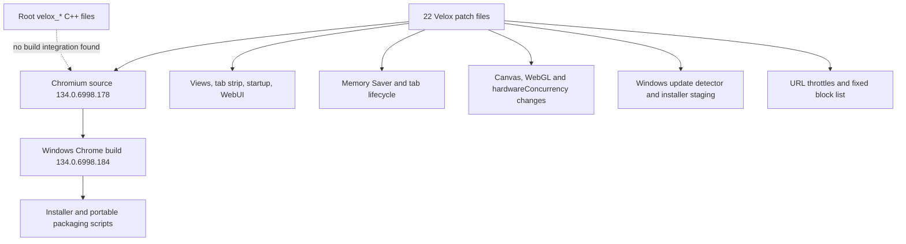

# Velox Technical Audit

**Audit date:** 2026-10-29  
**Scope:** Source, patch series, build configuration, tests, update and packaging scripts, documentation, and locally available Windows artifacts.  
**Outcome:** Suitable for continued engineering; not ready for a release candidate or wider distribution.

## 1. Executive summary

The repository contains a real Windows Chromium build and a substantial set of Velox patches. The root Git checkout was clean at `f1d52f7` (`main`, tracking `origin/main`). The separate, root-ignored Chromium checkout is based on commit `81fef1e264547cc88c9450117b091ea5798a5adf`, whose upstream version is `134.0.6998.178`; its local `chrome/VERSION` and built executable report `134.0.6998.184`.

The most serious release problem is the built-in updater. It downloads a manifest and installer through Windows URLMon, then launches the installer hidden. That path does not verify the manifest hash or the Authenticode signer, ignores the installer exit code, and can start automatically after detecting a newer version. The helper Python verifier also accepts arbitrary self-signed chains and `UnknownError`. The current `chrome.exe`, `mini_installer.exe`, and `velox_installer.exe` are all unsigned.

The Chromium base is also far behind upstream. On 2026-10-27, Chrome Stable for desktop was `156.0.8078.73/.74`; that release reports 52 security fixes. Velox is still based on milestone 134. This is a release-blocking security-maintenance gap, independent of Velox-specific patches. [Chrome Stable Channel Update, 2026-10-27](https://chromereleases.googleblog.com/2026/10/stable-channel-update-for-desktop_0562499947.html)

The existing Python suite ran 33 tests: 29 passed, 2 failed, 1 errored, and 1 skipped. Several “security” checks simulate policy logic instead of calling the C++ implementation. The documented memory reduction has no reproducible OS-memory evidence in the checked-in verification scripts. The Windows toolchain preflight succeeds, and release-mode build artifacts exist, but I did not rebuild Chromium. An isolated headless smoke attempt timed out after 30 seconds and produced no usable runtime result.

There is no demonstrated Site Isolation or sandbox regression in the inspected patch set. Those protections also have not been independently verified at runtime. The new `velox:` scheme and the Windows sandbox/COM workarounds need browser-level negative tests before release.

## 2. Project inventory and architecture

| Item | Observed state |
|---|---|
| Repository | `D:\\Velox`, root branch `main`, commit `f1d52f7`; root working tree was clean before this report was added. |
| Chromium source | `src/` is excluded by root `.gitignore`; source HEAD is `81fef1e264547cc88c9450117b091ea5798a5adf`, Chromium 134.0.6998.178. Local `chrome/VERSION` is changed to patch 184. |
| Patch series | 22 patches; 287 diff entries touching 192 distinct upstream paths, with 76 paths touched by multiple patches. |
| Build | Windows x64, release (`is_debug=false`), static (`is_component_build=false`), symbols stripped; `enable_widevine=true`, proprietary codecs enabled, `is_official_build=false`. `src/out/Default/chrome.exe` and `chrome.dll` exist; binary file version is 134.0.6998.184. |
| Build environment | `python scripts/build.py --check-env` passed. Python 3.11.9, Git 2.53, depot_tools, Visual Studio 2022 Build Tools, and Windows SDK 10.0.22621 were found. |
| Linux | `.gclient` targets only Windows. `src/out/TestLinux` contains only `args.gn`; no Linux executable or CI build was found. |
| Tests | Three Python test files/fixtures plus two CDP verification scripts. No CI workflow files were present. No Chromium C++ or browser test target was run in this audit. |
| Release | Installer artifacts exist but are unsigned and inconsistent in size/version. Multiple checked-in manifests refer to different releases. |

### Architecture map

Most shipped behavior comes from patches applied inside Chromium. The root `velox_shell/`, `velox_performance/`, `velox_security/`, and `velox_extensions/` C++ files are not referenced by a root GN target or copied by `scripts/apply_patches.py`; they appear to be unintegrated scaffolding. The actual custom WebUI and browser code lives under `src/` through patches.

## 3. Prioritized findings register

| ID | Severity | Category | Finding and evidence | Impact / confidence | Recommended fix |
|---|---|---|---|---|---|
| SEC-01 | P1 | Updates / supply chain | `src/chrome/browser/upgrade_detector/get_installed_version_win.cc:55-72,151-178,210-245` fetches the manifest and installer with `URLDownloadToFileW`, trusts `installer.download_url`, launches `velox_pkg.exe` hidden, and does not verify a hash or signer. The detected update can trigger installation automatically. The installer exit code is ignored. | **CONFIRMED code path;** compromise of the manifest or release channel can lead to code execution as the browser user. No exploit was run. | Disable the native auto-install path until the manifest is signed with a pinned key, package hash and publisher are verified, HTTPS/host/version are validated, failures preserve rollback, and the user receives a clear consent prompt. Test tampered manifest, hash, signature, URL, and installer failure cases. |
| SEC-02 | P1 | Chromium security maintenance | The source and executable are milestone 134. The current Stable desktop release is milestone 156 and reports 52 security fixes. | **CONFIRMED revision gap;** high impact for web-facing code. | Rebase onto a currently supported Chromium stable baseline and establish a frequent security-update cadence. Keep patches small enough to revalidate after every rebase. |
| REL-01 | P1 | Signing | Current browser and installer binaries return `NotSigned`. `scripts/sign_binaries.py:65-71` accepts any output containing “Signing Certificate Chain” without checking the result code or pinning the publisher; lines 79-80 accept PowerShell `UnknownError`. | **CONFIRMED.** There is no trustworthy release identity in the available artifacts; helper checks can accept untrusted signers. | Sign release artifacts with the production Velox certificate, pin the expected publisher identity, reject all untrusted/unknown states, and verify every staged binary before publication. |
| COMP-01 | P2 | Web compatibility / performance | `navigator_concurrent_hardware.cc:11` returns a fixed 8. Canvas readback and encoding mutate one pixel byte using a fixed-seed LCG (`base_rendering_context_2d.cc:2975-2979`, `image_data_buffer.cc:155-163`). Canvas encoding also allocates and copies the full image buffer on every encode. WebGL always reports a Windows D3D11 renderer string (`webgl_rendering_context_base.cc:3858,3868`). | **CONFIRMED implementation;** compatibility and CPU/temporary-memory effects are unmeasured. The fixed seed does not provide fresh random noise across browser restarts. | Remove per-pixel output mutation. If anti-fingerprinting remains a product goal, use a documented, consistent privacy design and test canvas export/readback, WebGL, worker sizing, WebGPU, and Linux behavior. |
| PERF-01 | P2 | Memory claims | `patches/0011-ram-optimization-memory-saver-and-lifecycle-tuning.patch` enables aggressive Memory Saver by default, with 5/15/30-minute discard settings and urgent protection reduced from 10 to 2 minutes. `docs/STATUS.md:26` claims a 708.9 MB to 605.3 MB working-set reduction. The phase 6 verifier checks discard state but does not measure OS memory; phase 9 reads one page's `JSHeapUsedSize`, not browser working set. | **CONFIRMED claim/evidence mismatch;** risks to unsaved page state and restoration latency are plausible but untested. | Make aggressiveness user-controlled and choose a less aggressive default until measured. Record private bytes, working set, renderer/browser/GPU separately across fixed workloads, including post-discard recovery and CPU/network effects. |
| TAB-01 | P2 | Session restore | `src/chrome/browser/prefs/session_startup_pref.cc:116-120` rewrites an explicit `DEFAULT` startup preference to `LAST`. | **CONFIRMED.** Users selecting the New Tab page at startup still get session restore, which can reopen pages they chose not to restore. | Preserve explicit user preference values. Add tests for new profile, explicit New Tab, explicit restore, crash recovery, and multi-window restoration. |
| PRIV-01 | P2 | Privacy / documentation | `docs/external-communication.md:12,28-31` documents `velox://settings/privacy` controls that are not registered in the patch set. Patch 0002 only changes the default UMA preference; there is no network capture proving “zero background telemetry.” The built-in updater uses URLMon outside Chromium's Network Service. | **CONFIRMED documentation gap;** actual background traffic is **NOT VERIFIED**. | Remove unsupported claims, implement only the controls that have a real UI and behavior, and capture startup/idle/navigation traffic with service-by-service classification. |
| SEC-03 | P2 | WebUI origin boundary | `content/common/url_schemes.cc:64-121` registers `velox:` as standard, secure, CORS-enabled, and service-worker-capable; it is also registered for WebUI handling. Tests only simulate scheme checks in Python. | **POTENTIAL RISK**, not a demonstrated origin bypass. Privileged pages expose host metrics and process IDs. | Add browser tests for cross-origin iframe, fetch, worker, redirect, `blob:`/`filesystem:` origin inheritance, and renderer navigation to every `velox:` host. Verify the browser process denies untrusted access. |
| UX-01 | P2 | Diagnostics UI | `velox_performance_ui.cc:94,115,122,162` hardcodes “ORIGIN ISOLATION ACTIVE,” “Win32k Lockdown + AppContainer,” process-tree headings, and discard policy rows. The page does not query those security states; it lists browser/renderers rather than the full utility/GPU/network process set. | **CONFIRMED.** Users can be shown security and topology claims that were not measured. | Label static policy descriptions as policy, and show security/process values only when read from runtime diagnostics. Add tests with varied process topology and disabled/unavailable features. |
| REL-02 | P2 | Release metadata | `dist/version.json` says 134.0.6998.184; `dist/website/version.json` says .182; winget says .178 and points to `github.com/Louay/velox`; `dist/package_release.ps1` defaults to .180. The checked-in Windows installer copies differ by 1,229,824 bytes. | **CONFIRMED.** Users can receive stale artifacts, URLs, or checksums. | Use one generated manifest source; validate version, URL, size, SHA-256, Authenticode, and installer/portable contents before upload. Remove user-specific `C:\Users\Louay` staging paths. |
| TEST-01 | P2 | QA | `python tests/run_tests.py`: 33 tests, 2 failures, 1 error, 1 skipped. Failures: reverse check for patch 0010; mini-installer/copy size mismatch. Error: patch registry test decodes a patch containing binary data as UTF-8. Many “security” and lifecycle tests duplicate intended logic in Python instead of calling C++. | **CONFIRMED.** Current test suite is red and does not establish browser security or compatibility. | Fix the suite, replace simulations with Chromium unit/browser tests, and add CI for clean patch application, Windows/Linux builds, security, extension, session, and release validation. |
| ARCH-01 | P2 | Patch maintenance | `scripts/apply_patches.py:5-6` promises automatic rollback, but `:44-63` applies sequentially and exits on first failure without undoing prior patches. Reverse mode also iterates ascending patch order. Dry-run checks each patch against one unchanged tree. | **CONFIRMED.** Failed patching can leave a partially modified Chromium checkout; patch validation is unreliable for overlapping changes. | Apply patches in a disposable worktree and validate the complete series. Reverse in descending order. Make rollback use a clean disposable checkout or explicit transaction, never destructive cleanup of unknown user work. |
| COMP-02 | P2 | Linux support | The quick installer in `scripts/velox-linux.sh:35-82` downloads and runs the Windows build with Wine. Its “native Linux build” function only prints instructions; the instructions use tag .182 and ignore failed patch application with `|| true` (`:112-137`). No Linux binary or CI build exists. | **CONFIRMED release gap.** Native Linux compatibility is **NOT VERIFIED**. | Either defer Linux support claims or produce and test a native Linux build from the same pinned source and strict patch series. Verify downloaded packages before execution. |
| TAB-02 | P3 | Test safety | `scripts/verify_phase_6_runtime.py:18-20,36-39` uses the fixed `D:\\Velox\\test-profile-phase6` path and recursively deletes it before launch. | **CONFIRMED.** Re-running the verifier can destroy existing profile/test data. | Require a newly created unique temporary profile and refuse to delete a pre-existing path. Preserve logs and artifacts under a unique run ID. |

## 4. Security and privacy assessment

### Threat model

| Threat | Current evidence | Assessment |
|---|---|---|
| Malicious website / cross-origin attack | Chromium 134 base; no `--disable-web-security` or `--no-sandbox` addition found in the reviewed patch/config text. New `velox:` origin is privileged. | **NOT TESTED** at runtime. Keep Chromium SOP and Site Isolation assumptions provisional until browser tests cover the custom scheme. |
| Compromised renderer | Chromium sandbox and process architecture are inherited. Patches 0005/0006 alter Windows AppContainer/Win32k/COM startup behavior. | No sandbox bypass was demonstrated. These sensitive startup changes need AppContainer and Win32k-lockdown browser tests on supported Windows builds. |
| Malicious extension | Chromium extension platform remains the primary implementation; Velox extension manager files at repo root are not integrated into the build. | MV3 fixture checks structure only. Permission boundaries, service worker suspension, DNR, password managers, and native messaging are **NOT TESTED**. |
| Malicious download | Safe Browsing is claimed enabled in docs; no download threat test was run. | **NOT VERIFIED**. Do not infer protection from a preference default alone. |
| Local attacker / profile theft | Profiles use Chromium storage under Velox paths. No ACL, secret-storage, or profile-migration security review was completed. | **NOT VERIFIED**. Avoid importing into another browser's live profile; test migration on copies. |
| Update/release supply-chain compromise | Native updater silently launches remote installer without digest or signer verification; release artifacts are unsigned. | **P1 release blocker.** |

### Privacy service classification

| Service | Classification | Evidence / status |
|---|---|---|
| UMA metrics | Optional | Default `kMetricsReportingEnabled` is set false by patch 0002. This does not prove that all background traffic is disabled. |
| Safe Browsing, CRLSet, component updater | Security-critical | Docs claim these remain enabled. Actual network behavior was not captured; status **NOT VERIFIED**. |
| Search suggestions | Optional | DuckDuckGo is selected as default in patch 0013. Network suggestion traffic was not tested. |
| Velox update polling | Functionality/security-critical | Native updater polls `dist/version.json` via URLMon. It runs outside Chromium's Network Service and its package validation is inadequate. |
| Static tracker blocking | Optional | `src/chrome/common/velox_shield_rules.h` has a fixed host list. No subscription/update mechanism or effectiveness benchmark was found. |
| Crash reporting, DNS/DoH, sync, promotional requests | Unknown | No network capture or complete source audit established their current behavior. |

## 5. Performance and memory assessment

| Optimization | Actual implementation | Expected benefit | Measured benefit | Risks | Recommendation |
|---|---|---|---|---|---|
| Memory Saver | Default enabled/aggressive; 5/15/30-minute discard intervals; urgent protection 2 minutes. | Reclaim background renderer memory. | No reproducible OS working-set/private-bytes result found. | Reload latency, unsaved form/app state, background network/CPU on restore. | **MODIFY** — user-selectable mode and controlled benchmark. |
| Spare renderer | `kSpareRendererForSitePerProcess` default disabled. | Avoid idle spare renderer allocation. | No per-process measurement. | First navigation may be slower; claimed 35–50 MB is unsupported here. | **INVESTIGATE** — compare startup memory and first-navigation latency. |
| Memory pressure | Releases discardable memory at moderate as well as critical pressure. | Return memory sooner under pressure. | No pressure workload result. | Repeated cache recreation, CPU and jank. | **INVESTIGATE** — test sustained pressure and interactive latency. |
| Canvas fingerprint modification | Full encoded buffer copy plus one-bit mutation; readback also changes a byte. | Intended to reduce fingerprint stability. | No privacy or performance measurement. | Image output changes; full-buffer temporary allocation/copy on every encode. | **REVERT** pending a tested privacy design. |
| Fixed hardware concurrency | Returns 8 on all devices. | Reduce exposed hardware detail. | No privacy measurement. | Worker-pool sizing and compatibility can regress on machines with very different core counts. | **MODIFY** after compatibility tests. |
| Session restore | Defaults to restoring last session, overriding `DEFAULT`. | Retain tabs across restart. | No restart/recovery test in the current suite. | Explicit preference ignored; unexpected pages reopened. | **MODIFY** to preserve user choice. |

The reported 708.9 MB → 605.3 MB figure has no raw capture or repeatable OS metric record in the repository. The phase 6 script verifies a discarded-tab state, not reclaimed bytes. The phase 9 script reads one renderer page's JavaScript heap and counts CDP target types; those are not browser-wide memory or OS process counts. The 18.6 ms N=5 page-load figure lacks a controlled network/cache workload and raw results. No custom V8 Lite Mode or GPU memory-budget switch was found in the reviewed Velox patches.

Use separate measurements for browser/renderer private bytes and working sets, shared memory, GPU process memory, and dedicated/shared VRAM. Do not sum overlapping working sets and call that physical use. A compact experiment should compare stock Chromium 134 and Velox on the same build host with: startup idle, 5/20 ordinary tabs, media and JS-heavy pages, extensions, discard/restore, closed tabs, sustained memory pressure, and 30-minute background CPU/network. Keep warm/cold cache runs separate.

## 6. Tab lifecycle and compatibility

| Area | Velox modification | Coverage / risk |
|---|---|---|
| Startup restore | Defaults to LAST and maps explicit DEFAULT to LAST. | User setting regression is confirmed; browser restart/crash scenarios untested. |
| Tab discard | Adds pinned-tab and in-progress download guards; also relies on Chromium lifecycle policy for other protections. | Python test uses a hand-written `is_protected` simulation. No audio, WebRTC, capture, form state, service worker, WebSocket, multi-window, or extension interaction test. |
| Canvas | Changes `getImageData` and encoded exports. | Direct standards-facing behavior change with no browser compatibility test. |
| WebGL | Replaces renderer/vendor strings with fixed values. | Windows-specific renderer string is emitted by the shared patch; graphics compatibility untested. |
| Request blocking | Static domain list and DuckDuckGo `/y.js` path rule. | No false-positive/redirect/subresource/WebSocket coverage or rule update process. |
| MV3 | No custom engine changes identified beyond Chromium. | One MV3 fixture; no durable test of password manager, ad blocker, productivity extension, DNR, or service worker suspension. |
| Media/DRM/WebRTC/WebGPU | Chromium base features remain configured; Widevine flag enabled. | Widevine architecture test was skipped because CDM was not provisioned. Media, WebRTC, WebGPU, WebAssembly, PWA, storage, clipboard, and notifications were not verified in this audit. |
| Linux | Wine path downloads Windows portable package; native helper is instructions only. | Native Linux support is **NOT VERIFIED**. |

The historical CDP verifier scripts may have exercised some paths, but the checked-in JSON status file does not preserve raw command output, browser version, environment, or reproducible artifacts. The Python suite itself does not repeat those browser tests.

## 7. UI, accessibility, and diagnostics

Patches 0012, 0016, 0018, 0020, 0021, and 0022 make substantial changes to branding, tabs, window chrome, themes, split view, and onboarding. The intended obsidian/cyan direction is present in source. This audit did not capture a native-window screenshot, test Windows display scaling, or evaluate keyboard-only, screen-reader, high-contrast, reduced-motion, or multi-monitor behavior. Those items remain **NOT TESTED**.

The performance WebUI is misleading in its current form. It computes host system memory and CPU count, lists the browser and renderer hosts, and prints static security/discard labels. It does not report the browser's complete process tree or prove that sandbox/Site Isolation is active. Rename it as a host snapshot or populate those claims from runtime APIs and label unavailable values.

## 8. Build, release, and upstream maintenance

- A Windows release-mode output exists, but the preflight command only checks dependencies; no clean rebuild was run. Current GN args are non-official, disable always-on DCHECKs, and do not define a verified production hardening profile. `docs/build.md` calls out `is_cfi=false` while labelling its security flags mandatory; reconcile that text with the actual supported Windows configuration.
- No `.github/workflows` or other CI configuration exists, despite `docs/STATUS.md:31` saying CI/CD workflows are verified.
- `dist/package_release.ps1` defaults to 134.0.6998.180 and stages portable files from a specific user's installed application directory. The root manifest is .184, website manifest .182, winget manifest .178, and local ignored `releases/version.json` used by tests is .178.
- The scheduled task in `scripts/register_updater_task.bat:16` runs `--check-only`; it does not install updates. `scripts/check_update.py` points at a different GitHub namespace and `releases/version.json`, while the native updater expects `dist/version.json`. These are distinct updater paths with different schemas and trust checks.
- `dist/upload_release.py` creates non-draft releases and deletes same-named existing assets. It has no signature/test gate. It was inspected but not executed.
- The patch series touches 192 upstream paths, and patch 0016 includes extensive UI/resource changes. There is no demonstrated rebase onto a recent Chromium branch. The documented 4-week cadence is not reflected in the current milestone.
- The Linux helper installs Windows Velox via Wine and downloads it without checksum verification. Its native-build instructions use a different source tag and silently ignore patch failures.

## 9. Remediation roadmap

### Immediate

1. Disable the native background installer path in release builds until signed-manifest and signer verification are complete. Add a hard stop for unsigned or unexpected publishers.
2. Move the Chromium baseline to a current supported stable revision. Revalidate every security-sensitive patch during the rebase.
3. Stop publishing unsigned artifacts. Make one release manifest authoritative and require exact version/hash/signature agreement before upload.
4. Correct `SessionStartupPref` so explicit New Tab preference remains respected.

### High priority

1. Remove the canvas pixel mutation and Windows-only WebGL spoof from shared renderer code; add compatibility tests before introducing any replacement privacy behavior.
2. Replace fake Python security/lifecycle simulations with browser tests for sandboxing, Site Isolation, custom `velox:` origins, downloads, extensions, session restore, and discard protections.
3. Change the Memory Saver default or expose its aggressiveness. Establish repeatable memory/CPU/latency baselines by process type.
4. Make patch application transactional in a disposable checkout; validate complete apply and reverse series in the correct order.

### Medium priority

1. Decide whether Linux means native Chromium or Wine compatibility. Publish only the platform actually built and verified.
2. Repair dashboard labels and implement accessibility, high-DPI, contrast, reduced-motion, keyboard, and multi-monitor checks.
3. Reconcile privacy documentation with actual controls and measure background requests before making telemetry claims.

### Optional refinement

Keep the tab-island/glass visual language only where it remains legible, accessible, and cheap to render. Add screenshot-based UI review and animation/repaint profiling after core correctness and security gates pass.

## 10. Release-gate checklist

### Mandatory security and correctness

- [ ] Current supported Chromium security baseline with documented rebase provenance.
- [ ] Signed release binaries and pinned publisher verification.
- [ ] Signed update manifest or equivalent authenticated metadata; verify installer hash, signer, version, URL scheme/host, exit code, and rollback before install.
- [ ] Browser tests for sandbox, Site Isolation, `velox:` origin boundaries, dangerous downloads, and update tampering.
- [ ] User startup preference and crash/session restore tests; discard tests cover media, downloads, pinned tabs, and unsaved application state.
- [ ] Clean Windows build and a real native Linux build if Linux remains supported.
- [ ] All tests green in CI from a clean checkout; test reports retain version, environment, commands, and artifacts.
- [ ] Release manifest, installer, portable package, winget metadata, and published website agree on version, URL, size, hash, and signature.
- [ ] Profile migration/installation/uninstallation tested on disposable profiles without touching Chrome/Edge data.

### Quality and polish

- [ ] Memory and responsiveness measured with distinct process, GPU, and OS metrics; no overlapping working-set sums.
- [ ] Canvas/WebGL/hardware concurrency compatibility matrix passes on Windows and Linux.
- [ ] Keyboard, screen reader, high contrast, reduced motion, DPI, resizing, and multi-monitor UI checks pass.
- [ ] Privacy claims correspond to implemented user controls and captured network behavior.

## 11. Test record

| Command / inspection | Result |
|---|---|
| `python scripts/build.py --check-env` | Passed; toolchain preflight reports ready. |
| `python tests/run_tests.py` | **Failed:** 33 run; 29 passed, 2 failed, 1 error, 1 skipped. Failures were patch 0010 reverse check and installer copy size mismatch; the error was UTF-8 decoding a binary-containing patch. Widevine CDM inspection skipped. |
| `Get-AuthenticodeSignature` on `chrome.exe`, `mini_installer.exe`, `velox_installer.exe` | All `NotSigned`. |
| `chrome.exe` file version resource | 134.0.6998.184. |
| Isolated headless `--dump-dom` smoke using a new scratch profile | Timed out after 30 seconds. It produced no usable DOM/runtime result; no conclusion about normal window launch is drawn. |
| `git status --short --branch` at root | Clean before adding this report. Chromium source is root-ignored and locally differs from its .178 baseline at least in `chrome/VERSION`; the complete `git diff --stat` exceeded the command wait window. |
| Profile contents, logs, external release upload, updater execution | Not accessed or executed. The test suite only enumerated installed browser-profile locations. |
