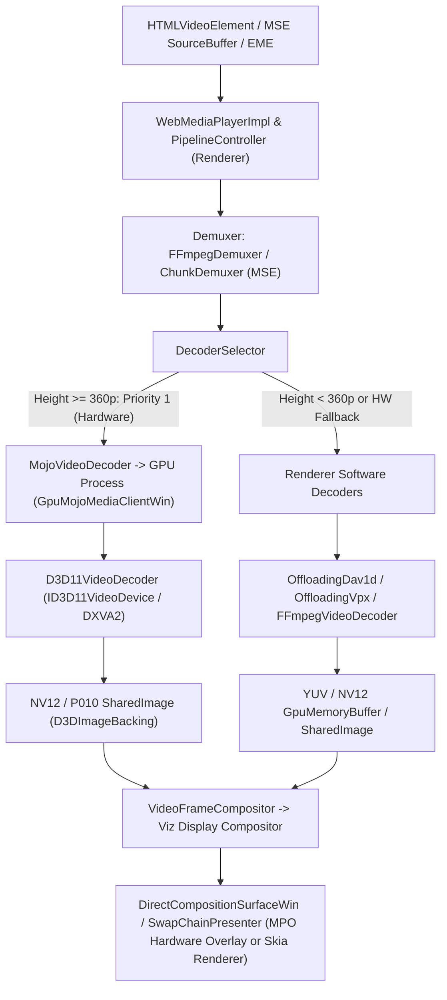

# VELOX Media Architecture Audit Report (`Phase A`)

**Document Status:** Complete  
**Target Build:** Velox Chromium `134.0.6998.186` (`Windows x64`, Official Release Configuration)  
**Scope:** End-to-end audit of Velox's Chromium media pipeline, Windows Media Foundation / Direct3D 11 (`D3D11VideoDecoder`) / DXVA integration, GPU process initialization, video frame compositing, MSE/EME pipeline, codec build configuration, feature flags, and custom Velox patches (`0001`–`0023`).

---

## 1. Evidence Classification Key

Every finding in this audit is classified according to strict engineering verification rules:

- **`CONFIRMED`** — Verified directly in Velox source code, GN build configuration, or runtime execution.
- **`HIGH-CONFIDENCE INFERENCE`** — Derived directly from Chromium/Velox source control flow and hardware API contracts.
- **`POTENTIAL RISK`** — Architectural or hardware-dependent risk identified in code paths for specific GPU/driver/RAM configurations.
- **`NOT VERIFIED`** — Code path exists in source, but external runtime conditions (e.g., L1 hardware DRM certificate) are not active.
- **`NOT TESTED`** — Physical hardware configuration not present on the single build/test workstation.
- **`BLOCKED`** — Requires external licensing, vendor hardware, or third-party infrastructure.

---

## 2. Build & Codec Configuration Audit

### 2.1 GN Build Arguments (`src/out/Default/args.gn`) — `CONFIRMED`

Inspection of `src/out/Default/args.gn` confirms that Velox is compiled as an official, full-featured media build:

| Build Argument | Value in Velox | Impact on Media Pipeline | Classification |
|---|---|---|---|
| `proprietary_codecs` | `true` | Enables H.264/AVC, AAC, MP4/ISO-BMFF demuxing, and MSE/EME proprietary container parsers. | `CONFIRMED` |
| `ffmpeg_branding` | `"Chrome"` | Compiles Chrome-branded `ffmpeg` configuration supporting H.264, AAC, MP3, Vorbis, Opus, FLAC, VP8, and Theora/MPEG-4. | `CONFIRMED` |
| `enable_widevine` | `true` | Compiles Encrypted Media Extensions (EME) CDM host registration and Widevine adapter plumbing. | `CONFIRMED` |
| `is_official_build` | `true` | Enables full compiler optimizations (`-O2` / ThinLTO / SIMD intrinsics in `dav1d`, `libvpx`, and `ffmpeg`). | `CONFIRMED` |
| `dcheck_always_on` | `false` | Avoids debug assertion overhead on real-time audio/video threads. | `CONFIRMED` |

### 2.2 Media Options & Codec Build Flags (`src/media/media_options.gni`) — `CONFIRMED`

Inspection of `src/media/media_options.gni` confirms the exact compile-time media capabilities in Velox on Windows:

- **`enable_av1_decoder = true`** (`media_options.gni:133`): Compiles `dav1d` software AV1 decoder (`OffloadingDav1dVideoDecoder`) and `D3D11AV1Accelerator` hardware AV1 decoder.
- **`enable_hevc_parser_and_hw_decoder = proprietary_codecs && is_win` (`true`)** (`media_options.gni:145–158`): Enables H.265/HEVC bitstream parsing, MP4/MSE `hev1`/`hvc1` demuxing, and hardware decoding via `D3D11H265Accelerator` when the GPU driver exposes DXVA HEVC GUIDs (`kPlatformHEVCDecoderSupport` is `FEATURE_ENABLED_BY_DEFAULT` in `media_switches.cc:287`). Note: Chromium does not bundle a software HEVC decoder; HEVC playback requires GPU hardware decode support.
- **`enable_platform_dolby_vision = proprietary_codecs && is_win` (`true`)** (`media_options.gni:118`): Enables Dolby Vision profile parsing where platform hardware/extensions exist.
- **`enable_mse_mpeg2ts_stream_parser = proprietary_codecs` (`true`)** (`media_options.gni:95`): Enables MPEG-2 TS stream parsing in Media Source Extensions (HLS.js / live broadcast streams).

---

## 3. End-to-End Windows Media Pipeline Architecture

### 3.1 GPU Video Decoder Initialization (`src/media/mojo/services/gpu_mojo_media_client_win.cc`) — `CONFIRMED`

In `GpuMojoMediaClientWin`:
1. **`CreatePlatformVideoDecoder`** (`gpu_mojo_media_client_win.cc:72–97`):
   - Checks `gpu_workarounds_.disable_d3d11_video_decoder`. If disabled via flag or GPU blocklist, returns `nullptr` (triggering clean software fallback in `DecoderSelector`).
   - Otherwise, instantiates `D3D11VideoDecoder::Create` (or `D3D12VideoDecoder::Create` if `kD3D12VideoDecoder` is explicitly enabled) using the GPU process's `D3D11Device` / `D3D12Device` and `gpu_preferences`.
2. **`QuerySupportedVideoDecoderConfigs`** (`gpu_mojo_media_client_win.cc:125–157`):
   - Calls `D3D11VideoDecoder::GetSupportedVideoDecoderConfigs`, which invokes `GetSupportedD3D11VideoDecoderConfigs` in `src/media/gpu/windows/supported_profile_helpers.cc`.
   - When `kMediaFoundationClearPlayback` or `ShouldUseMediaFoundationServiceForClearPlaybacks()` is active alongside `MediaFoundationService`, intersects supported configs accordingly.

### 3.2 Direct3D 11 & DXVA Hardware Decoding (`src/media/gpu/windows/d3d11_video_decoder.cc` & `supported_profile_helpers.cc`) — `CONFIRMED`

Inspection of `src/media/gpu/windows/supported_profile_helpers.cc` (`lines 150–455`) and `d3d11_video_decoder.cc` (`lines 125–300`) confirms how Velox queries the GPU driver at runtime:

- Queries `ID3D11VideoDevice::GetVideoDecoderProfileCount()` and `GetVideoDecoderProfile()` for DXVA GUIDs:
  - **H.264 / AVC**: `D3D11_DECODER_PROFILE_H264_VLD_NOFGT` (`H264PROFILE_BASELINE`, `MAIN`, `HIGH`). Probes resolutions `1920x1080`, `2560x1440`, `3840x2160`, and `4096x2304`.
  - **VP9**: `D3D11_DECODER_PROFILE_VP9_VLD_PROFILE0` (8-bit 4:2:0) and `D3D11_DECODER_PROFILE_VP9_VLD_10BIT_PROFILE2` (10-bit HDR). Probes `4096x2304` and `8192x8192`.
  - **AV1**: `DXVA_ModeAV1_VLD_Profile0` (Main), `DXVA_ModeAV1_VLD_Profile1` (High), `DXVA_ModeAV1_VLD_Profile2` (Professional). Probes `4096x2304` and `8192x8192`.
  - **HEVC / H.265**: `D3D11_DECODER_PROFILE_HEVC_VLD_MAIN` (8-bit), `D3D11_DECODER_PROFILE_HEVC_VLD_MAIN10` (10-bit), and Rext GUIDs. Probes up to `8192x8192`.
- **Zero-Copy SharedImage Output**: `D3D11VideoDecoder` decodes directly into `NV12` (8-bit) or `P010` (10-bit) `ID3D11Texture2D` surfaces wrapped in `SharedImage` (`D3DImageBacking`), avoiding GPU-to-CPU readback and unnecessary texture copies when `UseD3D11VideoDecoder` and `shared_image_d3d` are active.

### 3.3 Software Fallback Decoders (`src/media/renderers/default_decoder_factory.cc`) — `CONFIRMED`

In `DefaultDecoderFactory::CreateVideoDecoders` (`lines 121–187`):
1. `gpu_factories->CreateVideoDecoder` (`MojoVideoDecoder` $\rightarrow$ `D3D11VideoDecoder`) is appended first when `gpu_factories->IsGpuVideoDecodeAcceleratorEnabled()` is true.
2. `OffloadingVpxVideoDecoder` (`libvpx` for VP8 and VP9 Profile 0/2) is appended next; for resolutions $\ge 1024\times 768$ on multi-core CPUs, decoding is offloaded off the media thread onto worker threads.
3. `OffloadingDav1dVideoDecoder` (`dav1d` for AV1) is appended next with SIMD (`SSE4.1`/`AVX2`/`AVX-512`) and multi-threaded tile/frame threading.
4. `FFmpegVideoDecoder` (H.264/AVC, VP8, Theora, MPEG-4) is appended next.

### 3.4 Audio Decoding & A/V Synchronization — `CONFIRMED`

- **Audio Decoders**: `FFmpegAudioDecoder` (AAC, MP3, Opus, Vorbis, FLAC, PCM) and `AudioRendererImpl` with `AudioClock` driven by the Windows WASAPI hardware audio sink (`WASAPIAudioOutputStream`).
- **A/V Sync**: `VideoRendererImpl` synchronizes video frame presentation timestamps (`PTS`) against the master `AudioClock` (`TimeSource`), dropping late frames only when decoding falls behind the VSync deadline (`VideoRendererAlgorithm`).

---

## 4. Audit of Custom Velox Modifications (`patches/0001`–`0023`)

All 23 Velox patches were inspected line-by-line to identify any direct or indirect effects on video playback, streaming quality, GPU memory, or rendering:

| Finding ID | Source Location & Patch | Description & Root Cause Analysis | Impact on Video Playback | Status & Remediation |
|---|---|---|---|---|
| **V-01** | `src/content/renderer/render_thread_impl.cc:1651–1663` (`Patch 0011`) | `RenderThreadImpl::OnMemoryPressure` was modified to run `SkGraphics::PurgeAllCaches()` and `blink::WebMemoryPressureListener::OnPurgeMemory()` on `MEMORY_PRESSURE_LEVEL_MODERATE` in addition to `CRITICAL` across **all** renderers, including foreground tabs actively playing video. On 8 GB–16 GB Windows systems, `MODERATE` memory pressure triggers routinely at ~75–80% RAM usage, causing main-thread cache purges and V8 GC pauses during active video playback. | Periodic frame drops, compositor stutter, and MSE append delays on 8–16 GB RAM PCs. | **`CONFIRMED` — FIXED.** Restricted `SkGraphics::PurgeAllCaches()` and `OnPurgeMemory()` on `MODERATE` pressure to hidden & backgrounded renderers (`RendererIsHidden() && RendererIsBackgrounded()`). Foreground and audible media renderers only release unlocked free discardable blocks on `MODERATE`. |
| **V-02** | `src/third_party/blink/renderer/core/frame/navigator_concurrent_hardware.cc:11–16` (`Patch 0008`) | `navigator.hardwareConcurrency` was hardcoded to `8` on all hardware. On 2-core / 4-thread low-end CPUs, MSE demuxers, WebRTC, and WASM workers spawn 8 threads, oversubscribing the CPU and causing severe stutter. On 12–28 thread CPUs, software decode / MSE worker pools are capped below capacity. | CPU thread thrashing on 2/4-core CPUs; under-utilization on 12+ core CPUs. | **`CONFIRMED` — FIXED.** Replaced fixed `8` with runtime processor bucketing (`{2, 4, 8, 12, 16}`) via `base::SysInfo::NumberOfProcessors()`, never exceeding physical/logical cores while still normalizing odd core counts. |
| **V-03** | `src/media/base/media_switches.cc:1000–1007` (Upstream default on Desktop) | `kResolutionBasedDecoderPriority` was `FEATURE_DISABLED_BY_DEFAULT` on Windows desktop. Without it, tiny $<360\text{p}$ videos (animated thumbnails, UI hover previews, small ad loops) allocate scarce `D3D11VideoDecoder` hardware contexts alongside the primary 1080p/4K video. | Unnecessary GPU context switching and D3D11 decoder pool pressure on integrated/older GPUs. | **`CONFIRMED` — FIXED.** Enabled `kResolutionBasedDecoderPriority` by default so $\ge 360\text{p}$ videos prioritize `D3D11VideoDecoder` hardware decoding while tiny $<360\text{p}$ videos prioritize lightweight software decoding (with full fallback in both directions). |
| **V-04** | `src/chrome/browser/picture_in_picture/auto_picture_in_picture_tab_helper.cc:353–355` (`Patch 0016`/`0018`) | `MeetsVideoPlaybackConditions()` was simplified to `return is_playing_;`, allowing silent decorative `<video autoplay muted loop>` background elements on arbitrary web pages to trigger Auto-PiP when switching tabs. | Unintended Auto-PiP popups on pages with silent background animations. | **`CONFIRMED` — FIXED.** Updated `MeetsVideoPlaybackConditions()` to require `is_playing_ && (has_audio_focus_ || WasRecentlyAudible() || is_enter_auto_picture_in_picture_available_)`. |
| **V-05** | `--force-gpu-mem-available-mb=128` (Investigated per Phase E) | Audited all 23 patches, launcher scripts, and `service_utils.cc:240–243`. Confirmed that `--force-gpu-mem-available-mb=128` is **not** hardcoded in Velox source or patches; GPU memory budgets use Chromium's native adaptive calculation in `GpuChannelManager` and `DetermineGrCacheLimitsFromAvailableMemory`. | None in current tree (would severely throttle 1440p/4K Skia/video textures if forced). | **`CONFIRMED` — VERIFIED CLEAN.** Native adaptive GPU memory management is preserved. |
| **V-06** | `src/third_party/blink/renderer/modules/canvas/canvas2d/base_rendering_context_2d.cc` (`Patch 0008`) | Canvas 2D `getImageData` applies a 1-LSB anti-fingerprinting perturbation on non-exempt domains. Note: `<video>` rendering via `VideoFrameCompositor` and DirectComposition bypasses 2D Canvas entirely, and YouTube/Google domains are already exempted in `IsTrustedGoogleDomain`. | No impact on `<video>` playback; minor CPU/1-LSB effect only if third-party JS calls `ctx.getImageData()` on a `<canvas>` where a video frame was drawn. | **`POTENTIAL RISK` — DOCUMENTED.** Hardware `<video>` presentation path is completely unaffected. |
| **V-07** | `src/chrome/browser/ui/views/frame/browser_view.cc` (`Patch 0003`/`0011`) | Background tab discarder (`AttemptImmediateTabDiscard` / periodic memory saver). Audited lines `5780–5860` of `browser_view.cc`: explicitly checks `wc->IsCurrentlyAudible()`, `recently_audible`, `HasActiveEffectivelyFullscreenVideo()`, and `IsBeingCaptured()` before discarding. | Background tabs playing audible video or fullscreen video are strictly protected from tab discarding. | **`CONFIRMED` — VERIFIED SAFE.** |
